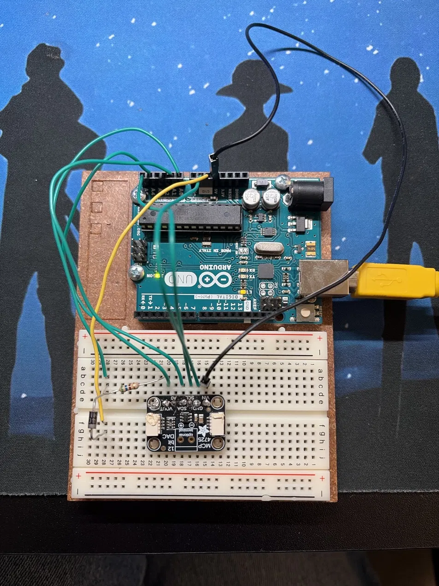

# Arduino Curve Tracer

An automated I-V curve tracer for diodes and LEDs (BJTs and MOSFETs planned), built with an Arduino Uno, an Adafruit MCP4725 12-bit DAC, and a Python plotting tool.

## Status: in development

Hardware bring-up is in progress. The DAC is detected over I2C (address 0x62) and accepts writes, but its output is not yet following the commanded code. I am debugging this with a multimeter and may replace the DAC board. **No measured I-V curves have been recorded yet.**

## How it works

The DAC output drives a 560 ohm sense resistor in series with the device under test (DUT), then to ground.

- A1 reads the voltage at the top of the resistor (V_src).
- A0 reads the voltage across the DUT (V_dut).
- Current: I = (V_src - V_dut) / R_SENSE
- The sweep stops automatically if current exceeds 8 mA.

## Hardware

- Arduino Uno R3
- Adafruit MCP4725 12-bit DAC (I2C: A4 = SDA, A5 = SCL)
- 560 ohm sense resistor
- Diode / LED under test, breadboard, jumper wires

## Software

- `curve_tracer_v1/curve_tracer_v1.ino`: Arduino firmware. Send `s` over serial (115200 baud) to run one sweep. Output is CSV: `code,v_src,v_dut,i_ma`.
- `plot_iv.py`: Python tool (pyserial, matplotlib) that triggers a sweep, saves a CSV, and plots linear and semilog I-V curves.

Usage: `python plot_iv.py <serial-port> <device-name>`

## Roadmap

- [x] Wire up Uno, DAC, sense resistor, and diode
- [x] Firmware and plotting script written
- [x] I2C communication with the DAC verified
- [ ] Fix DAC output so it follows the commanded code
- [ ] First clean I-V sweep of a 1N4007 diode
- [ ] Repeatability tests and LED sweeps
- [ ] Add BJT / MOSFET support
