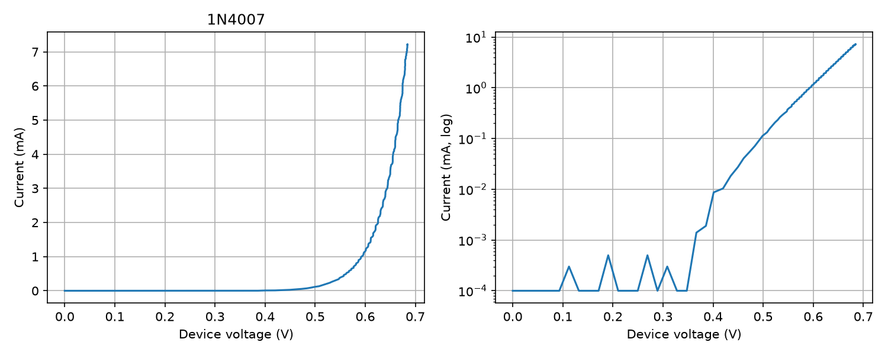
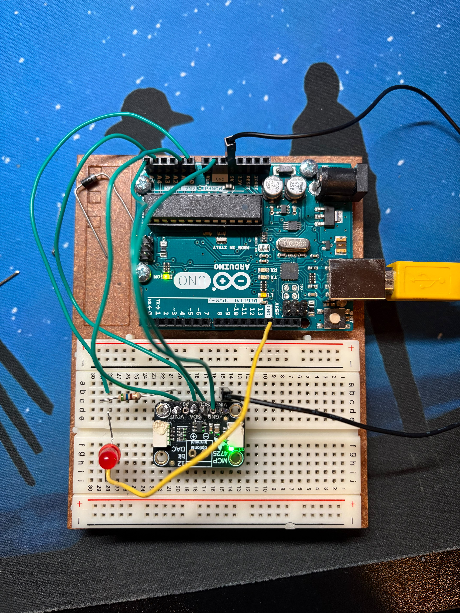
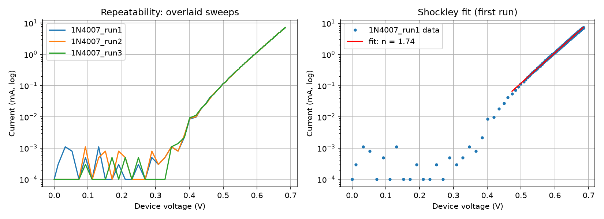
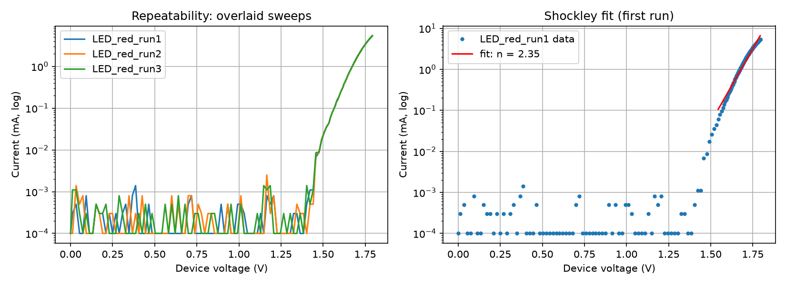

# Arduino Curve Tracer

An automated I-V curve tracer for diodes and LEDs (BJTs and MOSFETs planned), built with an Arduino Uno, an Adafruit MCP4725 12-bit DAC, and Python analysis tools.

## Status: working prototype

The tracer produces clean, repeatable I-V sweeps of a 1N4007 silicon diode and a red LED. Transistor support is next.

## Results

Each device was swept three times back to back. A Shockley fit was applied to 0.05 to 7 mA of each sweep, assuming room temperature of about 25 C (thermal voltage 25.69 mV).

**1N4007 silicon diode**

| Run | Ideality factor n | Saturation current Is | Voltage at 1 mA |
|---|---|---|---|
| 1 | 1.74 | 1.67e-09 A | 0.5926 V |
| 2 | 1.73 | 1.60e-09 A | 0.5931 V |
| 3 | 1.74 | 1.69e-09 A | 0.5927 V |

**Red LED**

| Run | Ideality factor n | Saturation current Is | Voltage at 1 mA |
|---|---|---|---|
| 1 | 2.35 | 8.36e-16 A | 1.6729 V |
| 2 | 2.32 | 5.72e-16 A | 1.6737 V |
| 3 | 2.35 | 7.78e-16 A | 1.6726 V |

- The voltage at 1 mA varied by 0.5 mV (diode) and 1.1 mV (LED) across three runs (short-term repeatability).
- Both semilog plots are straight lines over the fitted range, as the Shockley equation predicts.
- Results are from one diode and one LED in one session. The fitted n and Is depend on the fit range and series resistance, and Is moves together with n.

Known limits: the ADC step is about 5 mV, so currents below roughly 10 microamps are noise. The DAC output tops out near 4.7 V under load because the Uno's 5 V rail sags at about 7 mA.

## How it works

The DAC output drives a 560 ohm sense resistor in series with the device under test (DUT), then to ground.

- A1 reads the voltage at the top of the resistor (V_src).
- A0 reads the voltage across the DUT (V_dut).
- Current: I = (V_src - V_dut) / R_SENSE
- The sweep stops automatically if current exceeds 8 mA.

The DAC was verified by reading its unloaded output back with the Uno's ADC: measured voltage matched the commanded value within about 0.02 V from 0 to 4.9 V.

## Hardware

- Arduino Uno R3
- Adafruit MCP4725 12-bit DAC (I2C: A4 = SDA, A5 = SCL)
- 560 ohm sense resistor
- Diode / LED under test, breadboard, jumper wires

## Software

- `curve_tracer_v1/curve_tracer_v1.ino`: Arduino firmware. Send `s` over serial (115200 baud) to run one sweep. Output is CSV: `code,v_src,v_dut,i_ma`.
- `plot_iv.py`: triggers a sweep, saves a CSV, and plots linear and semilog I-V curves. Usage: `python plot_iv.py COM4 1N4007`
- `analyze_iv.py`: overlays repeated sweeps and fits the Shockley equation. Usage: `python analyze_iv.py run1 run2 run3` (saves `<run1>_analysis.png`)

Requires Python with `pyserial`, `matplotlib`, and `numpy`.

## Roadmap

- [x] Wire up Uno, DAC, sense resistor, and diode
- [x] Firmware and plotting script written
- [x] DAC output verified against commanded codes
- [x] First clean I-V sweep of a 1N4007 diode
- [x] Repeatability tests and Shockley fit (diode)
- [x] LED sweeps with repeatability and fit (red LED)
- [ ] Compare against a datasheet or LTspice model
- [ ] Add BJT / MOSFET support
