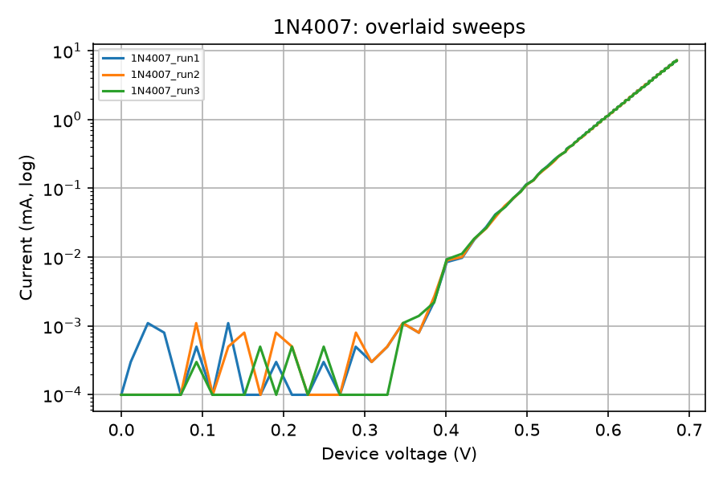

# Test report: 1N4007

Generated 2026-10-20 15:19. 3 sweeps.

| Run | Points | n | Is (A) | V at 1 mA (V) | Max current (mA) |
|---|---|---|---|---|---|
| 1N4007_run1 | 256 | 1.74 | 1.67e-09 | 0.5926 | 7.22 |
| 1N4007_run2 | 256 | 1.73 | 1.60e-09 | 0.5931 | 7.22 |
| 1N4007_run3 | 256 | 1.74 | 1.69e-09 | 0.5927 | 7.22 |

## Summary

- Ideality factor n: mean 1.74, spread 0.01
- Voltage at 1 mA: mean 0.5928 V, spread 0.5 mV

## Requirement checks (see docs/TEST_PLAN.md)

- R4 repeatability (spread <= 2.0 mV): **PASS** (0.5 mV)
- R2 current protection (max logged current 7.22 mA): **NOT VERIFIED (sweep ended below 8 mA, so the cutoff was not exercised)**

Fit assumes 25 C. Short-term repeatability only; single device.
